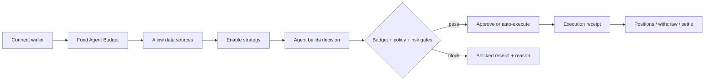
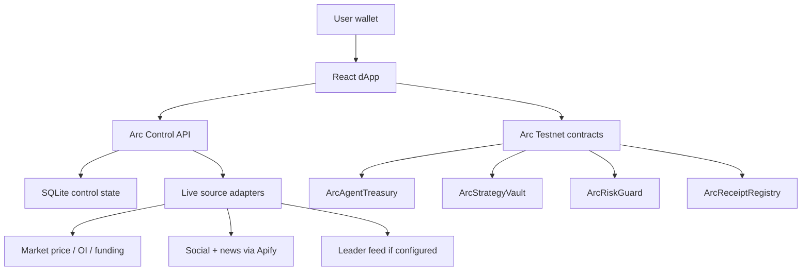

# ArcMind Control Layer

**Safe delegation for AI market agents on Arc.**

[](https://toll-gatee.vercel.app/)
[](https://tollgate-1.onrender.com)
[](https://www.arc.network/)
[](https://agora.thecanteenapp.com/)

ArcMind Control Layer lets a user give an AI market agent a limited USDC operating budget, approved data sources, allowed actions and risk rules. The agent can read market data, build decisions and execute only inside those constraints. User capital stays in a separate strategy vault, and every action leaves an auditable receipt.

The product is built for the **Agora Agents Hackathon by Canteen, Circle and Arc**: agents that trade, invest, create and interface with markets, settled instantly on Arc with USDC.

## Why This Exists

AI trading products usually answer one narrow question: **what should I trade?**

The hard product problem is different:

- Where does the agent get money for paid APIs and market actions?
- How much can it spend per call or per day?
- Which sources are trustworthy enough to influence capital?
- What happens if a source fails, a payment fails, or risk spikes?
- Can the user stop, withdraw or audit the agent without giving it a whole wallet?

ArcMind solves that control problem.

> The user does not give the agent a wallet. The user gives the agent a bounded budget, policy, risk guard and strategy vault.

## Product In One Flow



## What The User Can Do

The Arc workspace was redesigned around the Hyperliquid Vaults UX model in May 2026 — pick an agent, inspect its profile, copy with one click. Seven tabs replace the original twelve developer-facing screens.

| Tab | User question | Main actions |
|---|---|---|
| **Discover** | What agents can I copy? | Leaderboard: ArcMind (Arc, native) + every Hyperliquid vault from `vaultSummaries`. Sort/filter by APR / AUM / MDD / followers / age. Cross-chain Mirror button per Hyperliquid row (CCTP intent) |
| **Agent: ArcMind** | What is ArcMind doing and why? | Portfolio sparkline, win rate, Sharpe, 30d return, traded assets, fee schedule, source contribution per decision, followers count, ArcScan link for every on-chain action |
| **Copy & Position** | How do I copy with $X USDC? | Stake (min $1), risk profile, max drawdown, advanced Binance/Bybit-style settings (TP / SL / max position / slippage / copy mode), live realized + unrealized PnL split |
| **Receipts** | What proof exists? | Filter, export CSV, copy receipt id; embedded ERC-8183 Job lifecycle viewer (Open → Funded → Submitted → Terminal) with per-state ArcScan tx links |
| **Developer Console** | How do builders integrate this? | 13 collapsible power-user sections: Agent Budget, Strategies, Sources, Decision Room, Execution Queue, Risk Guard, Positions, Control Receipts, Portfolio, App Kit, x402, CCTP, Circle Tools |
| **Docs** | API reference | Full Docs portal |
| **Integrations** | Which chains/keys do I need? | Live integration grid |

## Why It Fits Agora

Primary fit:

- **RFB 06 - Social Trading Intelligence**: AI does not blindly copy leaders. It weights sources, checks risk decay and decides COPY, HOLD, REDUCE, STOP or MOVE_TO_USDC.

Secondary fit:

- **RFB 01 - Perpetual Futures Trading Agent**: risk guard, drawdown rules, stale-source blocking and emergency exit logic.
- **RFB 02 - Prediction Market Trader Intelligence**: source-weighted decision room and paid reasoning proofs.
- **RFB 04 - Adaptive Portfolio Manager**: strategy vault, risk-off routing and rebalancing controls.
- **RFB 05 - Cross-Platform Arbitrage Agent**: Arb Watcher can detect routes, but execution is gated by budget and policy.

## Funding Model

ArcMind separates money into four buckets.

| Bucket | Pays for | Does not pay for |
|---|---|---|
| **User Wallet** | Manual signatures, top-up, withdrawals, user-approved actions | Hidden autonomous retries |
| **Agent Budget** | Autonomous source reads, x402 calls, arb checks, agent operating costs | User strategy stake |
| **Strategy Vault** | User capital, exposure, reduce/close/settle/withdraw | Paid data sources |
| **Receipts Layer** | Audit trail for live, blocked and failed actions | Custody |

New Agora actions are **live-only**:

- no local fallback receipts for new actions;
- no seed BUY/HOLD/SELL data;
- no fake PnL, fake volume or simulated custody;
- if a live path is unavailable, the action is blocked with a concrete reason.

## Auto-Generated Markets (MarketFactory)

ArcMind ships a production `MarketFactory` so any new `(operator, baseSymbol, quoteToken)` triple can spawn its own isolated `CopyTradeMarket` contract. Every market is a separate Solidity contract with its own pause switch, fee schedule, stake bounds, and per-trader state — risk on one market never crosses into another.

```bash
cd contracts
ARC_USDC_ADDRESS=0x... ARC_PRIVATE_KEY=0x... npm run deploy:arc-market-factory
```

Deploys `AgentRegistry` + `MarketFactory` + the canonical ETH/USDC market, writes `contracts/deployments/arc-market-factory.json`. Adding a second market (e.g. BTC/USDC) is a single call:

```ts
await factory.createMarket(
  operator, usdc,
  "BTC/USDC",
  500,   // 5% performance fee (capped at 20%)
  1500,  // 15% kill-switch drawdown (range 5%-50%)
  1_000_000n,   // $1 USDC min stake
  1_000_000_000n,  // $1,000 USDC max stake
);
```

Security primitives across every new contract (OpenZeppelin 5.0.2):

- `Ownable` + `Pausable` + `ReentrancyGuard` + `SafeERC20`
- CEI (checks-effects-interactions) on every external transfer
- Per-parameter validation in constructor AND per-call (defence in depth)
- Custom errors with structured args (no string reverts)
- No `delegatecall`, no proxy, no upgradeability
- `sweepDust()` cannot drain quote token — user capital is segregated
- Factory enforces a global policy bound (max performance fee, kill-threshold range, stake floor/ceiling) on top of each market's own immutable bounds

The frontend Discover tab auto-discovers every market on every page load — set `VITE_ARC_MARKET_FACTORY` in your env and the "Native Arc Markets" section appears with live TVL, fees paid, settlement count, and pause state per market.

## Live Architecture



### Standards

- **ERC-8004** (Agent Identity & Reputation) — `AgentRegistry.sol` exposes `agentURI`, `agentReputation`, `agentOwner`, `agentDecisionCount` + emits standard `ReputationUpdated` events. Resolvers have a dedicated role; governors can slash misbehaving agents.
- **ERC-8183** (Agentic Commerce, Virtuals × Ethereum Foundation) — every copy-trade position emits `JobCreated → JobFunded → JobSubmitted → JobCompleted` events from `CopyTradeMarket`. The Receipts tab includes a live Job-lifecycle viewer.
- **Hyperliquid Info API** — POST `https://api.hyperliquid.xyz/info` with `vaultSummaries` / `vaultDetails` / `leaderboard`. Cached 60s in-memory; empty array on failure, never synthetic.
- **Circle CCTP v2** — domain numbers and USDC addresses for Ethereum/Arbitrum/Base/Optimism/Polygon are exposed via the Mirror modal; intents persist as receipts and will be replayable once Arc L1 is added to CCTP.
- **x402 USDC nanopayments** — agent operating costs settle in USDC per-call via `packages/sdk` (zero-dep client).

### `@arcmind/agent` package

The standalone autonomous agent runtime lives at `packages/arcmind-agent/`. Architecture matches ElizaOS plugin shape (Character + Providers + Actions + Evaluators + Service) with a local TypeScript shim of the public `@elizaos/core` types — drop in `@elizaos/core` later by changing one `types.ts` import, no business-logic rewrites needed.

Providers: `coingeckoPriceProvider`, `hyperliquidOiProvider`, `leaderFeedProvider`.
Actions: `decideEthDirectionAction`, `recordOnChainAction`.
Evaluator: `decisionAccuracyEvaluator` (feeds ERC-8004 reputation).

```ts
import { startArcMindAgent } from "@arcmind/agent";
const stop = await startArcMindAgent({
  settings: { ARC_PRIVATE_KEY: "0x…", ARC_AGENT_ID: "0x…" },
});
```

### Frontend

- React 19
- Vite 7
- TypeScript
- Tailwind CSS
- Workspace route: `/app/agora`

### Backend

- Express + TypeScript
- `better-sqlite3` control-state persistence
- x402-style service gateway
- Arc Control API
- live source adapters

### Contracts

**Production contract suite** (deploy via `cd contracts && npm run deploy:arc-market-factory`):

| Contract | Role | Source |
|---|---|---|
| `MarketFactory` | Permissionless factory — deploys one `CopyTradeMarket` per `(operator, baseSymbol, quoteToken)`; owner-configurable policy bounds | [`contracts/contracts/MarketFactory.sol`](contracts/contracts/MarketFactory.sol) |
| `CopyTradeMarket` | Per-market escrow: stake/settle/killSwitch/pause; immutable fee + drawdown bounds; ERC-8183 Job lifecycle events | [`contracts/contracts/CopyTradeMarket.sol`](contracts/contracts/CopyTradeMarket.sol) |
| `AgentRegistry` | Multi-agent registry with `AccessControl` (resolver + governor roles), slashing, ERC-8004 view interface | [`contracts/contracts/AgentRegistry.sol`](contracts/contracts/AgentRegistry.sol) |

**Live on Arc Testnet — `npm run deploy:arc-market-factory` 2026-05-23:**

| Contract | Address | Status |
|---|---|---|
| `AgentRegistry` | [`0x8aD47542EBbd92696E7C69E756bdf654d867581d`](https://testnet.arcscan.app/address/0x8aD47542EBbd92696E7C69E756bdf654d867581d) | live; `registerAgent` + `recordDecision` + `resolveDecision` all exercised, reputation 0 → 10 |
| `MarketFactory` | [`0x9C36Aa5fa856893Ae70E33014985678E4Ce198AD`](https://testnet.arcscan.app/address/0x9C36Aa5fa856893Ae70E33014985678E4Ce198AD) | live; `createMarket` exercised; 1 market deployed |
| `CopyTradeMarket` (ETH/USDC) | [`0xaef1bac4a9660bABCc78304580E1ea67749f0351`](https://testnet.arcscan.app/address/0xaef1bac4a9660bABCc78304580E1ea67749f0351) | live; `stake` + `settle` exercised; JobCreated/Funded/Submitted/Completed all emitted |

9 signed transactions across deploy + 6 function calls — full ERC-8004 + ERC-8183 lifecycle verified on-chain. Reproduce with `npm run verify:arc-deployments` (zero gas), `npm run exercise:arc-agent` (3 real tx), `npm run exercise:arc-market` (3 real tx).

**Legacy Arc Testnet deployment** (still live for the original 12-tab demo flow):

| Contract | Address |
|---|---|
| `ArcAgentTreasury` | [`0x4Cf79c89cFd85F788f6A0d8A27e0552902622869`](https://testnet.arcscan.app/address/0x4Cf79c89cFd85F788f6A0d8A27e0552902622869) |
| `ArcStrategyVault` | [`0xdBB4b61fC5Cbc2A456d56aFfF79a27e5155106d0`](https://testnet.arcscan.app/address/0xdBB4b61fC5Cbc2A456d56aFfF79a27e5155106d0) |
| `ArcRiskGuard` | [`0x0F066C8280E67F88B1c7959595E229541aFc531c`](https://testnet.arcscan.app/address/0x0F066C8280E67F88B1c7959595E229541aFc531c) |
| `ArcReceiptRegistry` | [`0xB5F9Ca1350c3EDA3FB2f0C0b7398C88BA2310693`](https://testnet.arcscan.app/address/0xB5F9Ca1350c3EDA3FB2f0C0b7398C88BA2310693) |
| `ArcMindRegistry` (ERC-8004 shim) | [`0xF4BFd93061B160Fa376c7F66De207a00225B4e70`](https://testnet.arcscan.app/address/0xF4BFd93061B160Fa376c7F66De207a00225B4e70) |
| `CopyTradeEscrow` (ERC-8183 events) | [`0x24Cb6d1bE131006e8CB2cb7fBa5675725f9E6Da8`](https://testnet.arcscan.app/address/0x24Cb6d1bE131006e8CB2cb7fBa5675725f9E6Da8) |

## Control API

Product-level routes:

```txt
GET  /api/arc/control/status
GET  /api/arc/control/budget
POST /api/arc/control/budget/top-up
POST /api/arc/control/budget/withdraw
POST /api/arc/control/policy

GET  /api/arc/control/sources
POST /api/arc/control/sources/refresh
POST /api/arc/control/sources/allow
POST /api/arc/control/sources/block

GET  /api/arc/control/strategies
POST /api/arc/control/strategies/enable
POST /api/arc/control/strategies/disable
POST /api/arc/control/strategies/run-once

GET  /api/arc/control/decision/latest
POST /api/arc/control/decision/build
POST /api/arc/control/decision/approve
POST /api/arc/control/decision/reject

GET  /api/arc/control/execution
POST /api/arc/control/execution/cancel
POST /api/arc/control/execution/retry

GET  /api/arc/control/positions
POST /api/arc/control/positions/open
POST /api/arc/control/positions/reduce
POST /api/arc/control/positions/close
POST /api/arc/control/positions/settle
POST /api/arc/control/positions/withdraw

POST /api/arc/control/risk/exit
POST /api/arc/control/risk/arm
POST /api/arc/control/risk/disarm
POST /api/arc/control/risk/reset

GET  /api/arc/control/receipts
GET  /api/arc/control/developer/status
```

Write routes return a single result shape:

```ts
type ControlWriteResult = {
  ok: boolean;
  status: "live" | "blocked" | "failed";
  reason?: string;
  txHash?: string;
  receiptId?: string;
  state?: ControlState;
};
```

## Source Layer

ArcMind never invents live data.

| Source group | Live source | Behavior when unavailable |
|---|---|---|
| Market price | Binance, Coinbase, Hyperliquid public APIs | Source marked unavailable; paid action can be blocked |
| OI / funding | Hyperliquid public API | Source marked unavailable or stale |
| Social / news | Apify-backed public source layer | `needs_key` if token is missing |
| Leader feed | `ARC_LEADER_FEED_URL` with sourced JSON | CopyGuard unavailable; SignalGuard mode remains |
| Developer paid sources | x402 service catalog | Hidden in Developer unless configured |

## Local Development

Install dependencies:

```bash
npm install
cd server
npm install
```

Run backend:

```bash
cd server
npm run dev
```

Run frontend:

```bash
npm run dev
```

Recommended local ports:

```bash
# backend
PORT=8787 npm run dev

# frontend
VITE_SERVER_URL=http://127.0.0.1:8787 VITE_API_BASE=http://127.0.0.1:8787 npm run dev
```

## Required Environment

Backend:

```txt
NODE_ENV=production
PORT=8787
CORS_ORIGIN=https://toll-gatee.vercel.app
X402_NETWORK=arc-testnet
X402_ASSET=USDC
X402_PAYOUT_ADDRESS=<Arc payout wallet>
ARC_RPC_URL=<Arc RPC URL>
ARC_PRIVATE_KEY=<dedicated funded Arc signer>
ARC_AGENT_ID=<agent id>
ARC_SIGNAL_SOURCE_MODE=live
APIFY_TOKEN=<optional social/news source layer>
TELEGRAM_BOT_TOKEN=<optional alerts>
TELEGRAM_CHAT_ID=<optional alerts>
OPENAI_API_KEY=<optional reasoning UX>
PINATA_JWT=<optional trace artifact storage>
```

Frontend:

```txt
VITE_SERVER_URL=https://tollgate-1.onrender.com
VITE_API_BASE=https://tollgate-1.onrender.com
VITE_ARC_AGENT_TREASURY_ADDRESS=0x4Cf79c89cFd85F788f6A0d8A27e0552902622869
VITE_ARC_STRATEGY_VAULT_ADDRESS=0xdBB4b61fC5Cbc2A456d56aFfF79a27e5155106d0
VITE_ARC_RISK_GUARD_ADDRESS=0x0F066C8280E67F88B1c7959595E229541aFc531c
VITE_ARC_RECEIPT_REGISTRY_ADDRESS=0xB5F9Ca1350c3EDA3FB2f0C0b7398C88BA2310693
VITE_ARC_MARKET_FACTORY=<MarketFactory address (enables on-chain market discovery)>
VITE_ARC_AGENT_REGISTRY=<AgentRegistry address>
VITE_ARC_RPC_URL=<Arc public RPC URL>
VITE_ARC_EXPLORER=https://testnet.arcscan.app
VITE_POSTHOG_KEY=<optional traction analytics>
VITE_POSTHOG_HOST=https://app.posthog.com
```

## Verification

```bash
# Frontend (96 tests)
npm test
npx tsc --noEmit
npm run build

# Contracts (34 tests including market factory + ERC-8004/8183 lifecycle)
cd contracts && npx hardhat test
cd contracts && npx hardhat compile

# Standalone agent package
cd packages/arcmind-agent && npx tsc --noEmit

# Server
cd server && npm test
cd server && npm run typecheck
```

Production smoke:

```bash
AGORA_FRONTEND_URL=https://toll-gatee.vercel.app \
AGORA_BACKEND_URL=https://tollgate-1.onrender.com \
npm run test:agora-live
```

## Security And Product Boundaries

- Agent Budget and Strategy Vault are separate.
- Agent Budget cannot pay user stake.
- Strategy Vault cannot pay data-source calls.
- Manual user-money actions require a wallet transaction.
- Autonomous paid actions require budget, policy and risk gates.
- Failed or blocked actions do not mutate budget or positions.
- Receipts show live transaction hashes only for real Arc transactions.
- Developer tooling is secondary and does not replace the user product flow.

## Repository Map

```txt
contracts/contracts/
  MarketFactory.sol               Production factory — auto-generates markets
  CopyTradeMarket.sol             Per-market escrow with full security primitives
  AgentRegistry.sol               ERC-8004 + slashing + AccessControl
  CopyTradeEscrow.sol             Legacy (still emits ERC-8183 events)
  ArcMindRegistry.sol             Legacy (ERC-8004 shim)
contracts/scripts/
  deploy-market-factory.cjs       Deploys factory + initial ETH/USDC market
contracts/test/
  market-factory.test.cjs         24 lifecycle + security tests
  arc-erc-compat.test.cjs         10 ERC-8004/8183 shim tests

packages/arcmind-agent/             ElizaOS-compatible standalone agent
  src/character.ts                ArcMind character file
  src/providers/                  CoinGecko, Hyperliquid OI, leader feed
  src/actions/                    decideEthDirection, recordOnChain
  src/evaluators/                 decisionAccuracyEvaluator
  src/service/arcMindService.ts   30-min decision loop
  src/types.ts                    Local shim of @elizaos/core types
  README.md                       Migration guide

src/lib/
  hyperliquid.ts                  Hyperliquid Info API client (vaults/leaderboard)
  cctp.ts                         CCTP intent + fee estimator (Mirror flow)
  marketFactory.ts                Read-only client for the on-chain factory
  agora.ts                        Arc helpers + ERC-8183 lifecycle reader

src/components/widgets/agora/
  ArcDiscoverWidget.tsx           Discover tab (native markets + Hyperliquid leaderboard)
  ArcAgentDetailWidget.tsx        Agent profile page (portfolio sparkline, reasoning)
  ArcMindOverviewWidget.tsx       ArcMind hero + position card
  ArcMindAlgorithmProfile.tsx     "Who am I copying?" shared card
  ArcMindWidgets.tsx              Copy & Position + reasoning trace widgets
  CrossChainMirrorModal.tsx       CCTP intent flow
  JobLifecycleViewer.tsx          ERC-8183 Open/Funded/Submitted/Terminal viewer
  ArcDeveloperConsoleWidget.tsx   13 collapsible power-user sections

src/pages/WorkspacePage.tsx       Agora tab dispatcher
src/workspaces/agora/             Workspace module
server/src/                       Express backend (SQLite control state, x402 gateway)
```

## Links

- Live product: [https://toll-gatee.vercel.app/](https://toll-gatee.vercel.app/)
- Backend: [https://tollgate-1.onrender.com](https://tollgate-1.onrender.com)
- GitHub: [https://github.com/kravadk/TollGate](https://github.com/kravadk/TollGate)
- Agora Agents Hackathon: [https://agora.thecanteenapp.com/](https://agora.thecanteenapp.com/)
- Arc: [https://www.arc.network/](https://www.arc.network/)
- Circle Developer Docs: [https://developers.circle.com/](https://developers.circle.com/)

